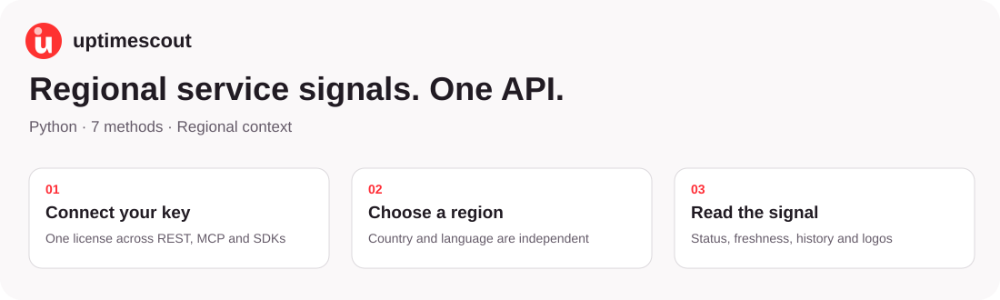

# UptimeScout API for Python

[](https://github.com/jsonscraper/uptimescout-api-python/tags)
[](#quick-start)
[](https://github.com/jsonscraper/uptimescout-api-python/commits)
[](LICENSE)

Read regional service availability, compare signals across countries and build status dashboards with seven API methods. Responses include observation timestamps, localized descriptions and versioned service logos.

**Package:** `uptimescout-api` · **[Quick start](#quick-start)** · **[Methods](#main-methods)** · **[Examples](examples/README.md)** · **[Integration guide](docs/guide.md)**

<picture>
  <source media="(max-width: 640px) and (prefers-color-scheme: dark)" srcset="docs/quickstart-mobile-dark.svg">
  <source media="(max-width: 640px)" srcset="docs/quickstart-mobile.svg">
  <source media="(prefers-color-scheme: dark)" srcset="docs/quickstart-dark.svg">
  
</picture>

## Quick start

**1. Get an API key.** Compare the [Free trial and paid plans](https://jsonscraper.com/services/uptimescout-api?utm_source=github&utm_medium=sdk&utm_campaign=uptimescout-api-python&utm_content=readme#pricing). Licenses are sold and managed by Evelode. The same UptimeScout license works with REST, MCP and every UptimeScout SDK.

Set the key in your server environment:

```sh
export UPTIMESCOUT_LICENSE_KEY='your-license-key'
```

PowerShell: `$env:UPTIMESCOUT_LICENSE_KEY = 'your-license-key'`.

**2. Install.** Requires Python 3.10+. These commands use the existing GitHub release; they do not assume that a package has been published to a registry.

```sh
python -m pip install "git+https://github.com/jsonscraper/uptimescout-api-python.git@0.1.3"
```

**3. Request a regional status.**

```python
import os
from uptimescout import Client, UptimeScoutError

client = Client(os.environ["UPTIMESCOUT_LICENSE_KEY"], timeout=30)
try:
    response = client.status("github", region="GB", lang="en")
    print(response["service"])
except UptimeScoutError as error:
    print(f"API request failed: HTTP {error.status}")
```

## Example response

A real public GitHub observation captured on **2026-11-18**, shown as a historical example. It is not a live status claim. License-specific usage fields are omitted.

```json
{
  "status": "ok",
  "region": "GB",
  "service": {
    "id": "github",
    "name": "GitHub",
    "category": "it",
    "status": "operational",
    "stale": false,
    "observed_at": "2026-11-18T03:11:21.650479Z",
    "age_seconds": 60,
    "regions": [
      "GB"
    ],
    "signal": "reported_availability",
    "scope": "regional",
    "logo_url": "https://uptimescout.com/static/brand-assets/github.svg?v=18e8fe76f953a31c",
    "logo_kind": "brand",
    "description": "Platform for Git repositories, code collaboration, issues and software delivery.",
    "description_language": "en"
  },
  "generated_at": "2026-11-18T03:12:21.928449Z",
  "data_type": "availability_observations",
  "stale_after_seconds": 600
}
```

`status` at the top level describes the API request. `service.status` describes the availability signal. Always read `stale`, `observed_at` and `region` together. The region selects observations; `lang` independently selects service-description language.

## Main methods

| Goal | REST endpoint | MCP tool |
| --- | --- | --- |
| Search the service catalog | `GET /v1/services` | `uptimescout_services` |
| Read one regional signal | `GET /v1/status` | `uptimescout_status` |
| Check several services in one call | `GET /v1/statuses` | `uptimescout_statuses` |
| Summarize selected services | `GET /v1/summary` | `uptimescout_summary` |
| Read observation history | `GET /v1/history` | `uptimescout_history` |
| Inspect observation statistics | `GET /v1/stats` | `uptimescout_stats` |
| Find fresh elevated signals | `GET /v1/incidents` | `uptimescout_incidents` |

[Complete parameters and pagination](docs/endpoints.md) · [Response fields and errors](docs/responses.md) · [OpenAPI specification](https://uptimescout.com/openapi.json)

## Ready-to-run examples

- [Search the service catalog](examples/endpoints/services.py).
- [Read one regional signal](examples/endpoints/status.py).
- [Check several services in one call](examples/endpoints/statuses.py).
- [Summarize selected services](examples/endpoints/summary.py).
- [Read observation history](examples/endpoints/history.py).
- [Inspect observation statistics](examples/endpoints/stats.py).
- [Find fresh elevated signals](examples/endpoints/incidents.py).

Each data example performs **one request**. Pagination is explicit; no example downloads the entire catalog or history automatically. Run `--help` first to see usage without sending a data request. JSON files in the MCP repository are request bodies, not executable scripts.

[Example commands for all seven methods](examples/README.md)

## Regions, languages and logos

Use a two-letter country code such as `GB`, `DE` or `JP`; discover current coverage in `available_regions`. Coverage can differ by service. Without `region`, responses may aggregate observed countries, so specify it when you need a regional answer.

Descriptions support 20 language codes: `en`, `ar`, `cs`, `de`, `es`, `fi`, `fr`, `he`, `it`, `ja`, `ko`, `nl`, `no`, `pl`, `pt`, `ru`, `sv`, `tr`, `uk`, `zh`.

Service metadata includes `description`, `description_language`, `logo_url` and `logo_kind`. Use the versioned HTTPS logo URL with its HTTP cache headers. `logo_kind` distinguishes a brand asset from a monogram fallback.

## Plans and request accounting

| Plan | Requests per minute | Services per batch | History window |
| --- | ---: | ---: | ---: |
| Free | 60 | 5 | 7 days |
| Starter | 300 | 10 | 7 days |
| Builder | 600 | 25 | 30 days |
| Pro | 1,800 | 50 | 90 days |
| Scale | 3,600 | 100 | 90 days |

The rate window is 60 seconds. A successful data call counts as one request, including a batch within your plan's limit. Each additional history page is another call. Failed or rejected calls do not consume the successful-request allowance. Respect HTTP 429 and `Retry-After` when present.

Usage resets on license renewal or a plan change, not on the first day of a calendar month. Annual plans provide twelve monthly allowances as one pool for the full license term, with the same rate limit. History is available only for periods in which observations were collected.

[Current prices and license-period allowances](https://jsonscraper.com/services/uptimescout-api?utm_source=github&utm_medium=sdk&utm_campaign=uptimescout-api-python&utm_content=readme#pricing) · [License management](https://evelode.com/checkout/purchase-history/)

## Understanding the data

Observations are updated every minute. A reported disruption signal is not a confirmed global outage or a direct uptime measurement. Regional signals can differ. Missing or stale observations remain unknown; sample statistics must not be labelled as an uptime SLA.

## Configuration and troubleshooting

[Runtime requirements, timeouts, error handling and pagination](docs/configuration.md) · [Full integration guide](docs/guide.md)

## Connect an AI assistant

Use the same license with the [UptimeScout MCP server](https://github.com/jsonscraper/uptimescout-mcp-server) or the [shared jsonscraper connector](https://jsonscraper.com/services/uptimescout-api?utm_source=github&utm_medium=sdk&utm_campaign=uptimescout-api-python&utm_content=mcp#connect). The dedicated endpoint is `https://mcp.uptimescout.com/mcp`. [Connection examples](docs/mcp.md).

## Support and license

The client source is [MIT-licensed](LICENSE); hosted API access uses a separate UptimeScout license.

[Service support](https://jsonscraper.com/contacts?utm_source=github&utm_medium=sdk&utm_campaign=uptimescout-api-python&utm_content=support) · [Report an SDK issue](https://github.com/jsonscraper/uptimescout-api-python/issues) · [Documentation](docs/guide.md)

When reporting a problem, include the client version, method, region and error status. Redact license keys and authorization headers.

The SDK and bridge contain no installation or API-usage telemetry. Documentation links use campaign parameters for website referral analytics. Service names and logos identify monitored services and do not imply endorsement or partnership.
